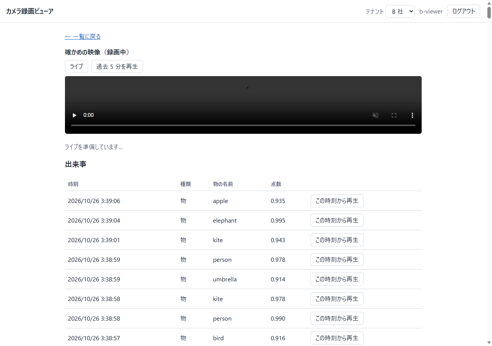
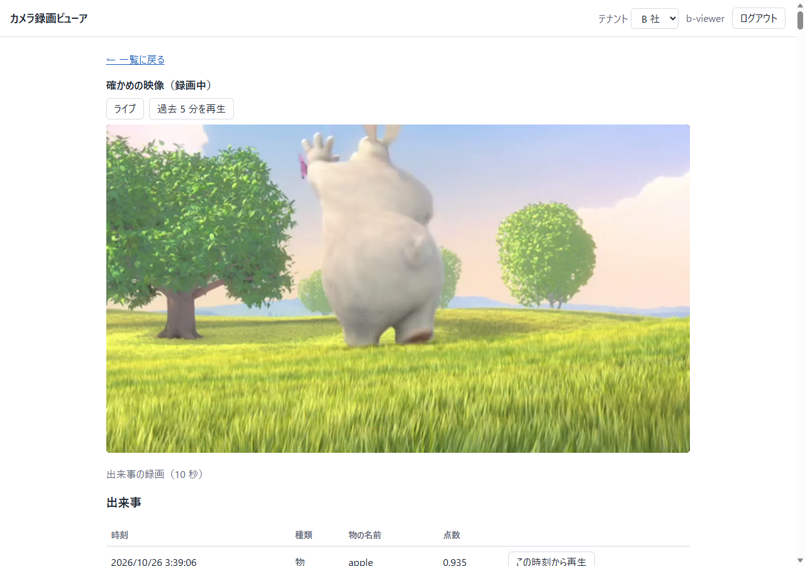

# camera-cloud-core

- **何をするものか**：監視カメラの映像を、会社ごとに分けて見せる仕組みの小さな見本です。A 社の担当者は A 社のカメラのライブ映像と過去 5 分の録画だけを見られ、他社のカメラは「見つかりません」としか表示されません。録画の中から「動きがあった時刻」と「写っている物の名前」も一覧にできます。
- **誰向けか**：複数の会社が使う監視カメラのクラウド（誰が何を見られるか、映像をどう守るか、台数が増えたらどうするか）を、動く形で確かめたい人向けです。製品ではありません。
- **結果**：1 台のノート PC の Docker で動きます。自動の試験（単体 419 本（ほかに Windows で skip される 2 本）、動いている環境に対する結合 52 + 42 + 11 本）が通り、コードを 19 か所わざと壊した確認ではすべて試験が赤になりました（[docs/validation/acceptance.md](docs/validation/acceptance.md)、[mutations.md](docs/validation/mutations.md)）。最初の版と後の版を同じ条件の負荷試験で比べた結果は [load_compare.md](docs/validation/load_compare.md) にあります。
- **版について**：この repository は 3 つ目の版から始まります。1 つ目と 2 つ目の版の API の形は `docs/openapi/`（`v1.json`、`v2.0.1.json`）の写しで、それぞれの版の結合試験は `tests/integration` と `tests/integration_v2` に残っています。

## 近い既存の OSS との違い

この repository が中心に置くのは、会社（テナント）ごとの分離、Keycloak での OAuth2 / OpenID Connect のログイン、映像の path ごとに出す短い JWT です。下の表は、設計の前に調べた OSS が、それぞれの README（Frigate は認証の説明書も）で自分をどう説明しているかです。ここに無い機能を「持たない」と言うものではありません。

| 名前 | その README / 説明書の説明 | この repository との違い |
|---|---|---|
| [Frigate](https://github.com/blakeblackshear/frigate) | 「A complete and local NVR designed for Home Assistant with AI object detection」。認証の説明書には admin・viewer と、カメラを限る役割があり、OIDC・SAML・LDAP は自前では実装せずプロキシ経由、と書いてあります | 1 つの NVR として録画と物の検出を持つ作りです。ここは会社ごとの分離と Keycloak でのログインに絞った見本です。ADR 0004・0005・0007 で Frigate の設定値とコードを読んだ記録を使っています |
| [Moonfire NVR](https://github.com/scottlamb/moonfire-nvr) | 「security camera network video recorder」。H.264 の RTSP をディスクに保存し、任意の時間範囲の `.mp4` をその場で作ります | 1 台の録画機として、録画の保存と索引の作りが中心です。ここは会社ごとの分離と権限が中心です。索引の考え方と録画の長さを ADR 0005 と docs/sources.md で参照しています |
| [ZoneMinder](https://github.com/ZoneMinder/zoneminder) | 「a complete surveillance solution allowing capture, analysis, recording and monitoring」 | カメラの取り込みから監視までを 1 つで行う監視システムです。ここは会社ごとの分離と、映像の権限の渡し方に絞っています。突き合わせの間隔を ADR 0005 で、動きの検出の設定値を ADR 0011 で参照しています |
| [Shinobi](https://gitlab.com/Shinobi-Systems/Shinobi) | 「Open Source CCTV Solution」。「multiple account system」を備えると書いています | CCTV の録画システムです。ここは Keycloak でのログインと、path ごとの短い JWT の確かめを見せるための見本です |
| [Kerberos Hub](https://github.com/kerberos-io/hub) | 「the single pane of glass for your Agents」。「Organize cameras with groups and sites」 | Kerberos の Agent をまとめて見て管理する側です。ここは会社・利用者・カメラの権限の分け方を見せます |
| [go2rtc](https://github.com/AlexxIT/go2rtc) | 「Ultimate camera streaming application」 | 映像を多くの形式で受け渡す部品です。ここは映像の受け渡しを MediaMTX に任せ、権限と索引の部分を作っています |
| [Viseron](https://github.com/roflcoopter/viseron) | 「Self-hosted, local only NVR and AI Computer Vision software」 | 自分の機器の中で動かす NVR です。ここは複数の会社で共有するクラウドの側を扱います |
| [Scrypted](https://github.com/koush/scrypted) | 「a high performance home video integration platform and NVR with smart detections」 | 家庭の映像をほかの機器やサービスにつなぐ基盤です。ここは会社ごとの分離を扱います |
| [Ant Media Server](https://github.com/ant-media/Ant-Media-Server) | 「Scalable open-source media server for live streaming」。録画とクラウドでの自動増減も挙げています | 配信のサーバーです。ここは配信の部分に MediaMTX を使い、その上の権限と索引を作っています |

監視カメラの録画を扱う、複数の会社（テナント）向けバックエンドの小型版です。会社ごとにカメラ・ライブ映像・過去 5 分の録画を分けて見せる仕組みの芯（誰が何を見られるか、映像の権限をどう渡すか、カメラの状態と録画の索引をどう持つか）を、1 台のノート PC の Docker で動く大きさで確かめるために作りました。後の版では、カメラの数で増える部分（映像・状態・録画の索引）を「stamp」として 2 組に分け、状態と区切りの書き込みを列（Valkey）で受けてまとめて書き、カメラが画面なしで自分を登録できる仕組み（Device Grant）を足し、最初の版と同じ条件の負荷試験で比べました。製品ではありません。

```
ブラウザ ─┬─ ログイン ───────────────▶ Keycloak（本人の確認だけ）
          ├─ /api/v1/... ──▶ gateway ─▶ api（FastAPI）── PostgreSQL（会社・所属・カメラの台帳・stamp の表）
          └─ 映像（短い JWT）──▶ 各 stamp の MediaMTX（ライブ HLS / 過去の再生 / 録画）

stamp 1（A 社・B 社）と stamp 2（C 社）は、同じ形の一式を 2 組持ちます。
  模擬カメラ ── RTSP（?token=）──▶ MediaMTX ──区切りごとに──┐
             └─ MQTT 5.0 ──▶ Mosquitto ──状態──────────────┤
                                                       writer ──▶ Valkey（列）──まとめて──▶ その stamp の PostgreSQL
カメラ登録（コード）: カメラ ─ Keycloak の device の口 ─▶ 管理者が確かめの画面で承認 ─▶ POST /api/v1/devices/enroll
```

最後の版では、録画の中身を見て「動きがあった時刻」と「写っている物の名前」を出来事として残し、画面から出来事の時刻の録画を再生できるようにしました（動きの検出は OpenCV の背景差分、物の分類は GPU で動く DETR。動きの検出だけを AI とは呼びません）。

設計の判断は [docs/adr/](docs/adr/) にあります（0001 部品の選定と脆弱性の確かめ / 0002 テナントの表し方 / 0003 認証と資格 / 0004 再生 / 0005 状態と索引 / 0006 stamp と control plane / 0007 列とまとめ書き・テナントごとの上限 / 0008 最初の API を 1 本ずつ置き換える / 0009 Device Grant でのカメラ登録 / 0010 負荷試験の方法と結果 / 0011 動きの検出と物の分類 / 0012 GPU をコンテナで使う / 0013 列のネットワークに足した 2 つの worker と守り）。見積もりは [docs/capacity.md](docs/capacity.md)、2 つの版の比べは [docs/validation/load_compare.md](docs/validation/load_compare.md)、読んだソースの記録は [docs/code-reading.md](docs/code-reading.md) です。これから入る人は [docs/design-guide.md](docs/design-guide.md)（設計の説明書。要求の流れ・映像の流れ・分離を守る 3 か所・道筋と worker を足す手順）から読んでください。要件は [docs/requirements.md](docs/requirements.md)、出所は [docs/sources.md](docs/sources.md)、事前の確かめの記録は [docs/validation/](docs/validation/) です。

## 使った技術

| 役目 | 使った物（版は固定） |
|---|---|
| ログイン | Keycloak 26.8.1（OpenID Connect、PKCE、Device Grant） |
| 映像の受け取り・配信・録画 | MediaMTX 1.21.2（HLS、RTSP、JWT での権限） |
| カメラの状態 | Mosquitto 2.1.2（MQTT 5.0） |
| 台帳と録画の索引 | PostgreSQL 17.11 |
| 列（まとめ書きの待ち行列） | Valkey 9.1.2 |
| 自作の部分 | Python 3.12（FastAPI、asyncpg、PyJWT）、閲覧の画面は静的な HTML と JS（hls.js、keycloak-js） |
| 動きの検出・物の分類 | OpenCV（背景差分）、PyTorch と DETR（`facebook/detr-resnet-50`、GPU） |
| 負荷試験・変異試験 | Locust、自作の script（`mutation/`） |
| 全体の起動 | Docker Compose |

版・ライセンス・image の hash は [ADR 0001](docs/adr/0001-components.md) と [THIRD_PARTY_NOTICES.md](THIRD_PARTY_NOTICES.md) にあります。

## 起動する

前提：Docker Desktop（`docker compose` が使えるもの。確かめたのは Compose v5.5.1 だけです）、Python 3.12（確かめたのは 3.12.10）、Node.js。メモリは 8 GB 以上の空きがあると安心です（コンテナごとの上限の合計は、最初から立つ 18 個で 5,504 MiB（約 5.4 GiB）、動きと物の検出の 3 個まで付けると 9,216 MiB（約 9.0 GiB）です。動きと物の検出の 2 つが使った量の最大は classify 約 2.2 GiB・motion 216 MiB でした（ADR 0012。読んだ値は残していません）。全体で使った量は測っていません）。

初回だけ、部品の取得とイメージの用意が要ります（各行の中身は固定の版で、ADR 0001 に一覧があります）。このリポジトリのフォルダ（この README のある所）で打ちます。

```
python -m venv .venv
.venv\Scripts\python -m pip install --no-deps --require-hashes -r requirements.lock.txt
npm install --prefix web --ignore-scripts --save-exact hls.js@1.7.3 keycloak-js@26.2.4
docker pull quay.io/keycloak/keycloak:26.8.1
docker pull bluenviron/mediamtx:1.21.2-ffmpeg
docker pull eclipse-mosquitto:2.1.2-alpine
docker pull postgres:17.11-alpine
docker pull valkey/valkey:9.1.2-alpine
docker pull python:3.12-slim
copy .env.example .env
docker compose build
```

（Linux / macOS では `.venv/bin/python`、`cp .env.example .env`。`.env` のパスワードはデモ用の値です。この PC の外から届く環境では変えてください。）

起動の 1 行：

```
docker compose up -d
```

全部が立つまで少し待ちます（かかった時間は測っていません）。止めるのは `docker compose down`、録画やデータベースも消すのは `docker compose down -v` です。

### 動きと物の検出（任意。NVIDIA の GPU が要ります）

`docker compose up` だけでは、動きと物の検出は動きません（GPU の無い機械でもそのまま始まります）。動かすには、先に動画・モデルの
重み・確かめの画像を `var/`（git に入りません）に取り、image を作り、profile `vision` を付けます。出所・大きさ・hash・ライセンスは
[docs/validation/vision_truth.md](docs/validation/vision_truth.md) と [THIRD_PARTY_NOTICES.md](THIRD_PARTY_NOTICES.md) にあります。

```
python -c "import os,hashlib,zipfile,urllib.request as u; d='var/bbb'; os.makedirs(d,exist_ok=True); z=d+'/BigBuckBunny_640x360.m4v.zip'; u.urlretrieve('https://download.blender.org/peach/bigbuckbunny_movies/BigBuckBunny_640x360.m4v.zip',z); assert os.path.getsize(z)==121284117,'size'; n=zipfile.ZipFile(z).namelist(); assert all('..' not in x and not x.startswith('/') for x in n),n; zipfile.ZipFile(z).extractall(d); print(hashlib.sha256(open(z,'rb').read()).hexdigest())"
python -c "import os,hashlib,urllib.request as u; d='var/models/detr-resnet-50'; os.makedirs(d,exist_ok=True); b='https://huggingface.co/facebook/detr-resnet-50/resolve/70120ba84d68ca1211e007c4fb61d0cd5424be54/'; [u.urlretrieve(b+f,d+'/'+f) for f in ('pytorch_model.bin','config.json','preprocessor_config.json')]; assert hashlib.sha256(open(d+'/pytorch_model.bin','rb').read()).hexdigest()=='883e4b0a898b87cc8ce28b33e04f86413984f67f7a44e96de5d05473bb0931b4','weights'; print('ok')"
python -c "import os,hashlib,urllib.request as u; d='var/check'; os.makedirs(d,exist_ok=True); p=d+'/000000039769.jpg'; u.urlretrieve('https://s3.amazonaws.com/images.cocodataset.org/val2017/000000039769.jpg',p); assert hashlib.sha256(open(p,'rb').read()).hexdigest()=='dea9e7ef97386345f7cff32f9055da4982da5471c48d575146c796ab4563b04e','image'; print('ok')"
```

確かめの映像 `var/bbb/check_clip.mp4`（180 秒。止めた絵 60 秒 + Big Buck Bunny の 60〜120 秒 + 止めた絵 60 秒）の作り方は
[docs/validation/vision_truth.md](docs/validation/vision_truth.md) にあります（camera の image の ffmpeg で作ります）。そのあと：

```
docker build -f services/vision/Dockerfile -t ccc-vision:3.0 .
docker compose --profile vision up -d
.venv\Scripts\python tools\setup_check_camera.py
```

`setup_check_camera.py` は、B 社のカメラ「確かめの映像」を API で登録し（B 社の管理者として）、秘密を volume `checkcam` に、カメラの ID を
`var/vision/cameras.txt`（動きを見るカメラの一覧）に置きます。何度流しても同じです。以前の版の volume が残っているときは、Valkey の
アカウントの定義が変わっているので `docker compose restart valkey` が要ります。

単体試験で動きの検出を流すには、手元の `.venv` に numpy と OpenCV を足します（`requirements.vision-test.lock.txt`）：

```
.venv\Scripts\python -m pip install --no-deps --require-hashes -r requirements.vision-test.lock.txt
```

## 見る

| 何 | どこ |
|---|---|
| 閲覧の画面 | http://localhost:8000/ |
| Keycloak の管理画面 | http://localhost:8080/admin（`.env` の `KC_ADMIN_USER` / `KC_ADMIN_PASSWORD`） |
| API の仕様 | http://localhost:8000/api/v1/openapi.json（固定した版は [docs/openapi/v1.json](docs/openapi/v1.json)） |

デモの利用者（パスワードは `.env` の `DEMO_USER_PASSWORD`、初期値は `.env.example` にあります）：

| ユーザー名 | 役割 |
|---|---|
| `a-viewer` / `a-admin` | A 社の閲覧者 / 管理者 |
| `b-viewer` / `b-admin` | B 社の閲覧者 / 管理者 |
| `c-viewer` / `c-admin` | C 社（stamp 2）の閲覧者 / 管理者 |
| `partner-admin` | パートナー管理者（A 社・B 社のカメラ一覧は見えるが、映像は見えない） |

（このほかに、負荷試験だけが使う `l-admin` / `l-viewer` が realm にあります。）

A 社・B 社・C 社は架空の会社です。カメラは 4 台（A 社 2 台・B 社 1 台・C 社 1 台）の模擬カメラで、同じ短い映像を繰り返し流します。C 社だけが stamp 2 で動きます（ライブは http://localhost:8889 、再生は http://localhost:9998 ）。

### 確かめる手順

1. 起動してから 5 分ほど待ち（録画の区切りは 60 秒ごとです）、`a-viewer` でログインします。カメラの一覧に「録画中」の 2 台が出て、「見る」でライブ、「過去 5 分を再生」で録画が見えます。
2. ログアウトして `b-viewer` でログインし直します。一覧に A 社のカメラは出ません。アドレスの `#/t/<A 社のテナント ID>/c/<A 社のカメラ ID>` を手で入れて開くと「見つかりません」と出ます（A 社の ID は `20000000-0000-4000-8000-00000000000a` と `30000000-0000-4000-8000-0000000000a1`）。

3. 画面なしのカメラを足します。`docker compose --profile device up -d cam-device` を打ち、`docker compose --profile device logs cam-device` に出る「enter the code XXXX-XXXX」のコードを控えます。`c-admin` でログインし、一覧の下の「カメラを追加」から Keycloak の画面を開き、コードを入れて「Yes」で承認します。1 分以内に「Device camera」が C 社の一覧に出て、ライブが映ります。片付けは `docker compose --profile device rm -sf cam-device` のあと `docker volume rm camera-cloud-core_devicecam` です。

4. （profile `vision` を起動してから）`b-viewer` でログインし、「確かめの映像」のカメラの頁を開きます。ライブの下の「出来事」に、動きの時刻と、物の名前・点数が並びます（数分たってから）。1 回に 100 件が並び、100 件を超えると表の下に「続きを読む」が出ます（ADR 0004）。「この時刻から再生」を押すと、その時刻の 5 秒前から、過去の録画が再生されます。録画は 1 日で消えるので、古い出来事は「録画は消えました」と出ます。動きの率とモデルカードの答えとの合否は [docs/validation/vision_eval.md](docs/validation/vision_eval.md) にあります。





（画面の中の映像は Big Buck Bunny。(c) copyright 2008, Blender Foundation / www.bigbuckbunny.org、CC BY 3.0。）

カメラの登録（管理者が秘密を写す方法）と利用者の追加は API で行います。例は [docs/requirements.md](docs/requirements.md) の表と `tests/integration/test_06_registration.py` を見てください。

## 試験

```
.venv\Scripts\python -m pytest -q -m "not integration"
```

単体の試験です。ネットワークは使いません。

結合の試験は、起動中の環境に外の口（gateway・Keycloak・MediaMTX・MQTT・RTSP）だけを叩いて確かめます。MQTT と RTSP の口を loopback に開ける追加のファイルを付けて起動してください。最初の版の試験（`tests/integration`、52 本、変えていません）と後の版の試験（`tests/integration_v2`）は別々に流します（同じ名前の `conftest.py` があるため）。

```
docker compose -f compose.yaml -f compose.test.yaml up -d
.venv\Scripts\python -m pytest -q -m integration tests/integration
.venv\Scripts\python -m pytest -q -m integration tests/integration_v2
.venv\Scripts\python -m pytest -q -m integration tests/integration_v3   # profile vision が動いている時だけ（GPU が無ければ理由を書いて skip）
```

後の版の試験は、2 つの stamp の分離・列（重複・同じカメラが 2 つ・書き込み役を止めた時・確認の無い物・dead）・テナントごとの上限・Device Grant・API の仕様の差分を見ます。

過去の再生の試験は起動後に録画がたまるのを待つので、起動直後に流すと全体で 4〜8 分かかります（起動から数分たっていれば 4 分ほど）。`docker kill` / `stop` / `pause` で状態が「切断」になるまでの秒数もこの中で測ります。結果の記録は [docs/validation/acceptance.md](docs/validation/acceptance.md) と [docs/validation/mutations.md](docs/validation/mutations.md) です。

変異試験（コードを 19 か所わざと壊して、赤になる試験を記録します。`--only m12_dead_at_sixth` のように名前を付けると、その場所だけを流して結果を表示します。記録のファイルは書き換えません）：

```
.venv\Scripts\python mutation\run_mutations.py                 # 単体の試験だけ
.venv\Scripts\python mutation\run_mutations.py --integration   # 起動中の環境でも
```

## 負荷試験

条件は [docs/validation/load_conditions.md](docs/validation/load_conditions.md)（測る前に固定）、結果は [load_v1.md](docs/validation/load_v1.md)・[load_v2.md](docs/validation/load_v2.md)・[load_compare.md](docs/validation/load_compare.md)・[load_v2_rerun.md](docs/validation/load_v2_rerun.md)（後の版の値を手本に合わせた後の測り直し）、方法と理由は ADR 0010 です。コンテナのメモリの上限の求め方は [docs/validation/memory_limits.md](docs/validation/memory_limits.md) です。やり直す時（3 回の測りで約 18 分（`run.json` の時刻から）と準備の時間。その間は PC で他の重い処理をしないでください）：

```
docker image ls ccc-loadtest   # 無ければ: docker compose -f compose.yaml -f compose.load.yaml --profile load build locust
docker compose -f compose.yaml -f compose.load.yaml -f compose.load.later.yaml --profile load up -d --no-build api gateway writer valkey mediamtx mosquitto postgres keycloak cam-a1 cam-a2 cam-b1 locust
.venv\Scripts\python loadtest\measure.py run --label v2 --files compose.yaml compose.load.yaml compose.load.later.yaml
.venv\Scripts\python loadtest\measure.py compare --label v2
```

最初の版（[load_v1.md](docs/validation/load_v1.md)）は、`compose.load.later.yaml` を付けない最初の版の構成で流したもので、その構成はこの repository には含まれていません。stamp 2 と `cam-c1` は測る間は止めておきます。

API の仕様の差分（最初の版を壊していないか）は [docs/validation/openapi_diff.md](docs/validation/openapi_diff.md) のとおり、oasdiff の公式 image で確かめました。

## 限界

- Keycloak は `start-dev`（開発用の内蔵データベース）で動かしています。実際の運用では `start` と本物のデータベース、TLS が要ります。
- TLS は使っていません（loopback だけに開けているため）。
- 映像の JWT は、接続や再生の最初に確かめられます。HLS の再生では、最初の要求のあとは `session` で通ることを試しました（docs/validation/poc.md）。期限が来たときに、送信中のカメラの接続が切れるかどうかは試していません（ADR 0003）。
- 署名の鍵は最初に 1 回だけ作ります。入れ替える手順は文書にあるだけで、まだ作っていません。
- API は 1 つです（テナントごとの上限はその API のメモリの中で数えています。API を複数にする時は Valkey に移します、ADR 0007）。stamp は 2 組ありますが、テナントを stamp の間で動かすこと・stamp を自動で増やすことはできません（ADR 0006）。動きと物の検出は stamp 1 だけで、GPU は 1 枚です（ADR 0011・0012）。出来事は録画より長く残ります（古い物は「録画は消えました」と出るだけです）。動きの検出は小さい物（画面の 0.5 % 未満）と、止まった物を見落とし、分類の名前はモデルが持つ 80 個（COCO の分類。モデルの `config.json` の `id2label` は 91 項目で、うち 11 は `N/A`）だけです（漫画の兎や栗鼠は出ません）。
- 負荷試験は、この repo で書いた部分（API・書き込み役・列）だけを測ります。映像そのもの（MediaMTX の配信）や Keycloak は測っていません。1 台の PC・Locust 1 台・3 回の結果で、2 つの版を同じ条件で比べたものです。カメラ何台まで持つか、は言えません（見積もりは [docs/capacity.md](docs/capacity.md) の式と仮定）。「100 万台で動いた」とは書きません。
- テナントの管理者が 2 つのテナントを持つ時は、コードでのカメラ登録は 409 で止まります（どのテナントか決められないため）。
- `docker compose build` の後に `compose.test.yaml` を付けずに起動した場合の API の中身と、チェックアウトのコードの差は、最後に作った image の一覧（ADR 0001）に書いてあります。
- ブラウザでの再生（hls.js の `Authorization` の付き方、過去の再生の blob）は、HTTP の応答までは確かめてありますが、実際のブラウザでの確認は別に行います（[docs/validation/poc.md](docs/validation/poc.md)）。
- 管理者のカメラ登録（コードを入れる画面は Keycloak のもの）と利用者追加の、自前の画面はありません。
- このリポジトリの自作の部分のライセンスは [LICENSE](LICENSE)（MIT）、使った部品のライセンスは [THIRD_PARTY_NOTICES.md](THIRD_PARTY_NOTICES.md) です。ffmpeg は MediaMTX の公式イメージの中のコマンドとして呼ぶだけで、このリポジトリには含めていません。

## 構成

```
compose.yaml            18 個のコンテナ + 要求した時だけ起動する 4 個（stamp 1: mediamtx mosquitto valkey writer postgres(control を兼ねる)、
                        stamp 2: mediamtx-s2 mosquitto-s2 valkey-s2 writer-s2 postgres-s2、共通: keycloak api gateway init、
                        模擬カメラ cam-a1 cam-a2 cam-b1 cam-c1、profile device の cam-device、profile vision の motion classify cam-b2）
compose.test.yaml       結合の試験用の追加（MQTT と RTSP を loopback に開ける、ソースを重ねる）
compose.load*.yaml      負荷試験の追加（CPU の上限と Locust のコンテナ。後の版は compose.load.later.yaml を重ねる）
infra/                  MediaMTX（stamp ごと）・Mosquitto・Keycloak（realm の取り込み）・stamp の一覧の設定
services/api/           制御の API（FastAPI）と書き込み役（同じ image）、番号付きの SQL（migrations/ と stamp_migrations/）、列とまとめ書き
services/gateway/       振り分け口（どの API が何を答えるかの表）と閲覧の画面の配信
services/camera/        模擬カメラ（ENROLL=device でコード登録、SOURCE_FILE で動画を繰り返し流す）
services/vision/        動きの検出（motion）と物の分類（classify）の worker と、その image の定義
tools/                  確かめのカメラの登録（setup_check_camera.py）と、動きと分類を測る道具（vision_eval.py）
web/                    閲覧の画面（静的な HTML と JS）
loadtest/               負荷試験（Locust の image・データの用意・遅れの測り・走らせて表にする script）
tests/                  単体（unit/）と結合（integration/ = 最初の版、integration_v2/ = 後の版、integration_v3/ = 出来事）
mutation/               変異試験（19 か所）
docs/                   要件・ADR（0001〜0013）・設計の説明書（design-guide.md）・出所・読んだソースの記録・見積もり・確かめの記録・API の仕様（v1.json・v2.0.1.json・v2.json）
poc/                    作る前の確かめに使った使い捨ての設定と script
```

## 映像・モデル・画像の出所と表示

- 動きの検出の確かめに使う映像は、**Big Buck Bunny**（Creative Commons Attribution 3.0）の一部です。**(c) copyright 2008, Blender Foundation / www.bigbuckbunny.org**（https://peach.blender.org/about/ ）。映像と、そこから作った映像は、このリポジトリにも image にも入っていません（`var/` に手元で取ります）。ただし `docs/images/` の画面の画像 1 枚に、その 1 コマが写っています。
- 物の分類は DETR（`facebook/detr-resnet-50`、revision `no_timm`、Apache-2.0。Carion ほか「End-to-End Object Detection with Transformers」）です。重みはこのリポジトリにも image にも入っていません。学習データは COCO 2017 です。注記は CC BY 4.0、画像は Flickr の利用条件の下にあります（https://cocodataset.org/#termsofuse ）。確かめの画像は COCO val2017 の 1 枚（モデルカードの例）です。
- 部品とライセンスの一覧は [THIRD_PARTY_NOTICES.md](THIRD_PARTY_NOTICES.md)、出所は [docs/sources.md](docs/sources.md) です。NVIDIA の CUDA ライブラリは PyTorch が引き込む物で、この PC の中の image で使うだけで、配っていません。
